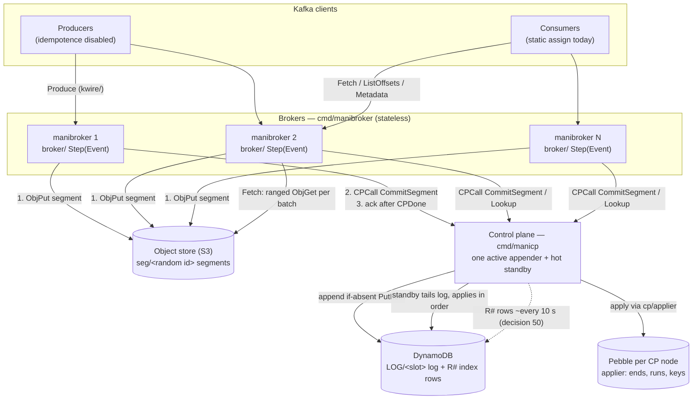

# Why Manifester keeps brokers, data, and metadata apart

You read this chapter before you read code. You learn why Manifester exists. You learn why the broker, the object store, and the control plane hold separate jobs. You also learn what the project leaves out. Later chapters explain the broker, the control plane, and the simulator in detail.

The view in this chapter is plain. Manifester trades produce latency for lower storage cost and simpler broker replacement. The deterministic core pays for that trade. The core lets the same code run in production and in a simulator that repeats a failure from one seed.

Every factual claim in this chapter traces to a file in this repository. Paths such as `core/doc.go` use the repository root as the base. The log in `docs/decisions.md` numbers each entry. The words decision 41 name that row.

Manifester is a Kafka-compatible broker written in Go. The module is `manifester` in `go.mod`. The broker keeps no local disk for log data. The broker PUTs producer record batches into segment objects. S3 or another object store holds the segment objects. A separate control plane service owns all metadata. The control plane records which segments exist. The control plane also records the offsets that the control plane assigned to each batch inside a segment.

Brokers hold no durable state. One broker can replace another broker. Any broker can accept a produce for any partition. The control plane assigns offsets only when the control plane commits a segment. The broker acknowledges a producer only after that commit is durable.

The broker is a single-threaded deterministic state machine. The machine has the signature `Step(Event) -> []Action`. The same logic runs in production against real S3 and DynamoDB. The same logic also runs in the seeded single-goroutine simulator in `sim/`. The simulator injects crashes, lost responses, and slow storage. The simulator must reproduce any failure from the seed alone.

## Kafka cost grows because one machine does three jobs

A conventional Kafka cluster puts three jobs on the same machines. The machines serve requests. The machines store log data on local disks. The machines copy that data between brokers and zones. You scale partitions by scaling brokers. You retain data by retaining disks. A broker failure starts a new copy of the data. Section 5 compares this design with WarpStream from public sources.

Manifester splits the three jobs in the list below.

- Data lives in object storage. The broker PUTs batches once to S3 as segment objects. Object storage gives durability. Brokers never copy log data. Decision 5 says "No local disk in v1."
- Metadata lives in a separate control plane. The control plane is a distinct HTTP service in `cp/`. The binary is `cmd/manicp`. The control plane assigns offsets. The control plane records where every batch landed. Brokers never see the control plane storage directly. See decision 3 and `core/controlplane.go`.
- Brokers hold no durable state. Any broker can serve any partition. The design has no partition leadership, broker epoch, or fencing. See decisions 29 and 44. A dead broker loses only memory. The object store or the control plane holds everything durable.

The trade is latency for cost and simplicity. A produce waits for an object store PUT and a metadata commit. The broker can acknowledge the produce only after the PUT and the commit finish. `loop.md` gives this example.

```text
ProduceReq ──► Step ──► [S3Put(seg-42)]
S3PutDone  ──► Step ──► [MetaCommit(p0: 100..199)]
CommitDone ──► Step ──► [Reply(conn7, offset=100)]     ← ack happens here, never earlier
```

That order is the durability contract. The broker acknowledges no offset before the object store holds the data. The broker acknowledges no offset before the control plane applies the commit. Simulator invariants check this rule. `loop.md` item 13 states the rule as "no offset acked unless it's durable".

## Three binaries run the split

The diagram below shows the parts and the order of the calls between the parts.



The table below is book apparatus. You use the table as reference. The argument in this chapter does not depend on you memorising the table.

| Binary | Source | Role |
|---|---|---|
| `manibroker` | `cmd/manibroker` | Kafka broker. It handles the wire protocol, buffering, sealing, PUT, commit, and ack. |
| `manicp` | `cmd/manicp` | Control plane service. It appends commands to the log, applies them, assigns offsets, and answers `Lookup` and `DescribeTopics`. |
| `manisim` | `cmd/manisim` | Simulator runner. It runs the broker with fake S3, a fake control plane, and fake clients. It uses one goroutine per seed. |

The list below names the package that owns each part. You meet the packages in this order in the book.

- `core/` has plain-data Events and Actions, the `StateMachine` contract, and the `Env` interface. The package does no input or output.
- `broker/` has the broker state machine.
- `kwire/` has Kafka framing and codec code built on franz-go `kmsg`. See decision A.
- `format/` has the segment byte layout and keys. See decision 22.
- `cp/` has the control plane handler and stores. The package also has `cp/cpclient`, `cp/logcp`, and `cp/applier`.
- `sys/` has the production runtime. The package has TCP, goroutine executors, real S3 and DynamoDB adapters, and metrics.
- `sim/` has the simulator kernel and the fault-injecting engines.
- `veritas/` has executable specs. The project uses the specs as independent oracles. See decision 21.

## One deterministic step lets the same machine run in production and in simulation

One rule shapes the shape of the code. The rule follows.

> All stateful logic is a single-threaded function `Step(Event) []Action`. The function does no input or output. The function reads no clock. The function draws no randomness except through an injected `Env`. Everything else exists to feed events in and carry actions out.

`core/doc.go` states the rules for deterministic packages. The rules cover `core/` and `sim/`. Continuous integration enforces the rules. The packages must not import `time`, `math/rand`, `crypto/rand`, `os`, `net`, `sync`, or any software development kit. The packages must not use goroutines, channels, or `select`. Map iteration must never decide behaviour.

Events and actions are plain data. `core/machine.go` defines the contract. `StateMachine` calls `Step` the only place state changes. The contract says `Step` never blocks. The contract says `Step` does no input or output. `Machine` adds `StateHash()`. The contract requires hashing. `Factory` builds a fresh machine on each boot. The boot case includes a boot after a crash.

`core/event.go` and `core/action.go` define the event names and the action names. Events include lifecycle events such as `Started` and `Stop`. Events include network input such as `BytesReceived` and `ConnClosed`. Events include timers such as `TimerFired`. Events include a completion for every input or output action. The completions include `ObjPutDone`, `ObjGetDone`, `CPDone`, and `SendDone`. Each completion has a matching correlation `ReqID`.

Actions include `ObjPut`, `ObjGet`, `CPCall`, `Send`, `SetTimer`, and `PauseReads`. Actions also include `Trip` and `Exit`. `Trip` means fail-stop. You use `Trip` when the machine can no longer trust memory. `Exit` means graceful shutdown.

Input and output always stay asynchronous. An action goes out. A `...Done` event comes back. Nothing inside `Step` waits. See `loop.md` item 6.

Timers work the same way. `SetTimer` goes out. `TimerFired` comes back. A generation number matches the timer request and the timer event. A stale timer therefore causes no harm. The segment flush timer in section 4 works this way.

### Production runs `Step` on one goroutine and carries out actions on many goroutines

`sys/` runs the machine in production. `cmd/manibroker` wires the machine and the runtime together. Reader goroutines push `BytesReceived` into a bounded data inbox. Executor goroutines run S3 PUTs and control plane HTTP calls. Executor goroutines push completions into a strict-priority control inbox. See decisions G and H.

Exactly one goroutine dequeues events. The goroutine takes control events first. The goroutine uses the shared pure function `core.InboxPolicy`. The goroutine then calls `Step`. Hundreds of PUTs may run at once. Only `Step` runs serially. `Step` mutates only memory. `loop.md` puts the time for `Step` at microseconds. The same note puts the production cost of the design at a plain function call. The note measures that cost in nanoseconds. The note contrasts that cost with S3 calls that take milliseconds.

### Simulation runs the same machine on one goroutine and one virtual clock

`sim/` and `cmd/manisim` run the machine in simulation. One goroutine owns everything. The goroutine owns a global queue. The queue orders events by `(simTime, seededRandomTie, seq)`. See decision 18. The goroutine owns one seeded random number generator. The goroutine owns a virtual clock. The clock jumps to the next event.

The fake engines inject faults. The engines inject random latency, 503s, and timeouts. The engines can report a PUT as lost after the PUT succeeds. The engines can duplicate completions. The engines can reorder completions. The engines can crash and restart the broker at any event. See `loop.md` item 12.

A crash discards broker memory. The broker then rebuilds from the object store and the metadata store. That rebuild works because brokers hold no durable state. Section 1 describes that choice.

The simulation uses no real goroutines, sockets, or wall clock. The same seed gives the exact same history. The simulator checks invariants after every step. The simulator hashes state into a running trace hash. Continuous integration runs each seed twice. The second run catches leaked nondeterminism. See `loop.md` items 13-15.

A failure gives you one command. The command has the form `go run ./cmd/manisim -scenario kafka-log -seed <n>`. The determinism rules stay strict for one reason. Production code and simulated code are the same code.

## A produce earns an acknowledgement only after the PUT and the commit

The four steps below form one sequence. Each step waits for the step before the step.

1. Buffer and seal. `broker/` collects batches from many clients and partitions into one open segment. The broker seals the segment at 16 MiB. The broker also seals the segment 200 ms after the first batch enters the segment. Later batches do not extend that fixed timer. The segment holds at most 4096 partitions and 256 batches. See `broker/config.go` and decisions 35 and 52. The broker stores batches verbatim. The verbatim bytes include compression. The broker validates headers and CRCs. The broker decompresses nothing. See decision 45.
2. PUT to object storage. The segment becomes one object at `seg/<random id>`. The id has 128 random bits in hex. The broker draws the id through `Env.NewID()`. Keys therefore stay deterministic in simulation. See decision 43. The `format/` layout has a header, a per-batch index, and the opaque batch bytes.
3. Commit. The broker issues `CPCall{CommitSegment{SegmentKey, Batches}}`. See `core/controlplane.go`. The request has no offsets. The control plane assigns each batch a `Base`. The control plane sets `Base` to the current end of the partition. The control plane advances in request order. Offsets stay contiguous per partition. The control plane decides offsets at commit time. The control plane does not decide offsets at upload time. A commit stays idempotent per segment key. An identical retry returns the original ranges. The same key with a different request returns `ErrConflict`.
4. Acknowledge. The broker replies only after the applier applies the slot for the commit. Section 6 describes the applier. Commit retries run to a 120 s deadline. The deadline has the name `CommitDeadline`. See decision 47. A control plane restart or failover therefore stalls acknowledgements. The restart or failover does not fail the acknowledgements.

Fetch follows a similar path. `Lookup` asks the control plane which runs hold offsets from a given point. The broker then runs ranged GET requests. The broker patches each batch `baseOffset` and leader epoch. Both fields sit outside the batch CRC. The CRC therefore stays valid. See decision 30 and `broker/fetch.go`.

## WarpStream shares the broad split and differs in the parts that matter

Manifester and WarpStream share broad design choices. Manifester is a separate clean-room project. One document gives the only approved comparison. The document is `docs/warpstream-architecture-comparison.md`. That document calls itself a "desk study from PUBLIC sources only" in section 0 of the document. The sources are published docs, the blog, and marketing pages.

No one studied the vendor container image for that document. The project treats reverse engineering as presumptively prohibited. A separate teardown exists outside the committed tree. Section 0 of `docs/roadmap-from-warpstream-teardown.md` recommends legal advice before anyone publishes material derived from the teardown. Section 0 also recommends that you keep the teardown out of the repository. You do not cite the teardown.

`docs/warpstream-architecture-comparison.md` verifies several points from public sources. The document marks the verified points [V]. The WarpStream agent is "a single stateless binary". The agent has no local disks. The agent has no cross-AZ replication. One file holds many topics and partitions.

WarpStream writes buffer for a default of 250 ms or 8 MiB. A file has a maximum of 4 MiB. The agent then PUTs the file. The agent commits metadata to a hosted journaled metadata store. The store has the name "Virtual Cluster". The agent acknowledges only after that commit. The store assigns order and offsets at commit. Reads use a zone-aware distributed file cache. The cache loads data roughly once per zone.

Manifester uses the same broad design. Brokers hold no durable state. Segments hold batches from many partitions. The broker PUTs, then commits, then acknowledges. The control plane assigns offsets at commit.

The mechanisms differ in most other respects. Manifester hosts the control plane for Manifester. Manifester uses a DynamoDB command log with a Pebble applier. Section 6 describes that log and that applier. WarpStream hosts the metadata store for WarpStream.

Manifester drops idempotent producers. WarpStream supports idempotent producers. Manifester lacks compaction. Manifester lacks the zone-aware cache. Manifester lacks backend consumer groups.

You read the side-by-side table in section 3 of the comparison document before you claim parity. You read the ranked takeaways in section 4 of the comparison document too. The document warns you about the cost figures in the document. The document calls the cost figures hypotheses until someone measures the cost figures from a bill.

## One ordered log gives every broker the same offsets

The production control plane uses a log, slots, and an applier. See decisions 48-53, `docs/log-cp-service.md`, and `cp/logcp/doc.go`.

The list below explains why the log has the shape that the log has.

- Brokers send every `CommitSegment` to one active control plane node. That node is the appender. Other control plane nodes are hot standbys. The standbys follow the log. All brokers use the same appender. You spread commits across nodes and you get back the contention of the earlier design. See decision 48.
- The appender writes the raw command into the next slot. The command has no offsets. One slot is one DynamoDB item. The item has the name `LOG/<slot>`. The appender writes the item only if the item is absent. The slot acts as the fence. Two candidate appenders race on the same slot. One appender wins. The other appender retries later. Safety needs no lease. See decision 51.
- Every replica applies slots in strict order through `cp/applier`. See decision 49. The applier is an embedded Pebble key-value store. The applier keeps partition ends. The applier keeps one packed run per partition and segment pair. The applier keeps per-key idempotency records. Offsets exist only after apply. The control plane answers a commit only after the applier of the control plane applies that slot.
- The idempotency window is a deterministic function of slot number. `WindowSlots` is 131,072. See decision 53. Every replica therefore forgets the same keys at the same log point. Slots carry a version. A replica meets a newer format and stops. The replica serves 503. The replica does not skip the slot. Upgrades take two deploys.
- A background indexer writes the per-partition `R#` DynamoDB index rows after the ack. The indexer runs about every 10 s. See decision 50. `Lookup` answers from applier memory. The project accepts work to move the index itself to S3. The project does not schedule that work. See `docs/TODO.md`.

An older control plane remains in the tree. The older control plane used a DynamoDB transaction store first. The older control plane then used a single sequencer with group commit. See decisions 39, 42, and 46, and `cp/doc.go`. The log store is the benchmark default.

## What Manifester leaves out limits the claims you can make

The list below names the absent parts. Each item names the file or the decision that records the absence.

- Consumer groups are absent. The broker serves exactly five Kafka APIs. The APIs are Produce, Fetch, ListOffsets, Metadata, and ApiVersions. Produce covers v3-9. Fetch covers v4-12. See `kwire/supported.go`. The broker serves no FindCoordinator, JoinGroup, OffsetCommit, or transactions. Benchmarks consume with static `assign()`. Consumer groups are roadmap item 4 in `docs/roadmap-from-warpstream-teardown.md` section 2. The estimate is 35-45 engineer-days. No one has built consumer groups yet.
- Idempotent producers are absent by decision. Decision 41 removed idempotent producers. Delivery is at-least-once. Idempotent batches get `INVALID_REQUEST`. Clients must disable idempotence. Clients use franz-go `kgo.DisableIdempotentWrite()` or `enable.idempotence=false`. Retries can duplicate records. Retries can also reorder records within a partition. That reorder case needs `max.in.flight.requests.per.connection > 1`. `docs/TODO.md` says idempotent producers are "explicitly not planned". A retried segment commit cannot duplicate records. Section 4 explains why a retried segment commit cannot duplicate records.
- The consumer read path is minimal. Fetch answers immediately. Fetch ignores `MinBytes` and `MaxWait`. Fetch therefore has no long-polling. See decision 29. Fetch runs one ranged GET per batch. Fetch does no coalescing. Fetch has no cache. Fetch costs one control plane `Lookup` per partition. See `broker/fetch.go`. Audit arithmetic measured one idle consumer at about 20.6k Lookups per second locally. Audit arithmetic predicted about 6.5k GET per second at 1 GiB per second of reads. The read path work is roadmap item 1. The work covers long-poll, a Lookup cache, coalesced GETs, and a chunk cache. `docs/TODO.md` calls the work "needed before any consume stage". You treat every produce number in this book as produce-only until that work lands.
- Compaction, retention, and garbage collection are absent. The broker never merges segments. The broker never deletes segment objects. Orphans from failed commits therefore accumulate. See roadmap item 2. The audit notes a present hazard. A bucket lifecycle rule could delete live `seg/` objects today. You treat that rule as a hazard to know. You do not copy that rule.
- Metadata names only the answering broker. See decision 29. Client failover therefore depends on the seed list. Client failover takes about 5 s with franz-go defaults. `docs/TODO.md` accepts work to list every live broker through a heartbeat lease. No one has done that work. The project declined per-broker partition ownership. That choice keeps brokers interchangeable.
- TLS, SASL, and ACLs are absent. Roadmap section 2 calls TLS, SASL, and ACLs "required before a serious OSS announcement". You do not expose these binaries beyond a trusted network.
- The control plane has a single appender by design. Failover costs an ack gap. Run w4 measured the gap at about 8 s at 500k messages per second. See section 8.

## The current evidence proves less than the headline numbers suggest

The repository states the caveats plainly. You repeat the caveats. You do not soften the caveats.

Run w4 is the main measurement. See `docs/w4-log-store-results.md`. The run bears the dates 2026-10-20 and 2026-10-21. The run used single availability zone ap-south-2a. Six `m6in.4xlarge` brokers used the log-backed control plane. The brokers held about 998k messages per second for a 4-minute stage. The rate equals about 975 MiB per second across 288 partitions. The stage used 64 producers, 1 KiB lz4, and produce only. Publish p99 was 756 ms. The run had zero errors.

The control plane used little capacity during run w4. Append p99 was 8 ms. The control plane used about 0.2 of 4 cores. The control plane ran at 20-32 slots per second. The team killed the active appender at 500k messages per second. The kill gave an about 8 s ack gap. The kill gave zero producer errors.

This path replaced an older commit path. The older path failed at about 240-275k messages per second in w2 and w3. The w4 document summarises those runs.

The w4 document also states the caveats. The stages were short. Each stage ran 1 to 4 minutes. Each stage had no warm-up. Each stage had one sample. The document calls the stages indicative. The document denies that the stages give a steady-state characterisation. No run measured more than 288 partitions. The run used one availability zone. The run therefore supports no cross-AZ cost claim. The run produced no consumer latency number. The run produced no end-to-end latency number.

Cost per GiB came from unit prices. Cost per GiB did not come from a bill. Local numbers in `docs/benchmarks.md` predate decisions 41-44. The local numbers say so. You never quote a figure without the stage length and the sample count.

The simulator gives separate evidence. The `kafka-log` campaign ran 2,000 seeds with 0 failing. The campaign ran 50.7M steps. The campaign re-checked determinism every tenth seed. Each deliberate mutant failed within 6 seeds. See `docs/sim-log-engine.md`. That result covers logic under injected faults. That result does not cover steady-state performance. That result does not cover multi-AZ performance. That result does not cover consumer performance.

The project itself is early. The project is a pre-release single-author research codebase. The project has fewer than two hundred commits. `docs/roadmap-from-warpstream-teardown.md` section 3 gives a bus factor of 1. The repository had no root `LICENSE` or `README.md` at the time of that roadmap. The roadmap marks both files as BLOCKERs for open-sourcing. The module is still the non-importable `module manifester` in `go.mod`, with go 1.24.

Determinism continuous integration lives at `build/ci/determinism.workflow.yml`. Determinism continuous integration does not live in `.github/workflows`. You read the open source checklist in the roadmap before you assume any release process exists.

## Glossary

The glossary below is book apparatus. You use the glossary to check a name. The glossary does not add new claims.

- Broker. One `manibroker` process. The broker runs the stateless Kafka-protocol state machine in `broker/` through `Step`. The broker buffers produces. The broker seals segments. The broker PUTs segments. The broker commits through the control plane. The broker serves Fetch from object storage. Any broker can serve any partition. See decisions 29 and 44. Brokers hold no durable state.
- CP. CP names the control plane. The control plane is the separate `manicp` HTTP service in `cp/`. The control plane owns metadata. The metadata includes topic partition counts and per-partition end offsets. The control plane records which segment holds which offset range. The control plane alone assigns offsets. See decisions 3 and 42. The control plane assigns offsets through `CommitSegment`, `Lookup`, and `DescribeTopics` in `core/controlplane.go`.
- Segment. One immutable object at `seg/<random id>`. The segment holds verbatim batches for many partitions. The segment holds up to 4096 partitions by default. The broker seals the segment at 16 MiB or after a 200 ms window. See `broker/config.go` and `format/`. A segment is the unit of PUT, commit, and idempotent retry.
- Run. The contiguous slice of one partition log from one segment commit. The run records `[Base, Base+Count)` mapped to byte ranges inside one segment. See `core.BatchRange`. The control plane stores one packed item per partition and segment pair. See decision 39. A partition log is a sequence of runs. The end offset of a partition log is the newest run `Base+Count`.
- Slot. One numbered position in the control plane DynamoDB command log. The item is `LOG/<slot>`, written if-absent. The item holds one or more raw commands and no offsets. Replicas apply slots in strict order. The slot fences the appender against a standby. See decisions 48, 51, and 53. Trimmed slots become tombstones.
- Applier. The deterministic state machine in `cp/applier`. Each control plane replica runs the applier over the log. Applying a slot assigns offsets, extends runs, and records idempotency keys in the embedded Pebble store of the applier. The control plane acknowledges a commit only after the applier applies the slot for the commit. Replicas apply the same slots and reach the same state. See decision 49. `veritas/` is the independent oracle.

## Reading order for your first week

You do not need to read the repository from top to bottom. You read the repository in data flow order. You keep `docs/decisions.md` open beside the code.

The five steps below form one sequence. You do the steps in order.

1. Start with `loop.md` and `core/`. Read `doc.go`, `machine.go`, `event.go`, `action.go`, and `controlplane.go`. The files run to a few hundred lines together. The files define every noun used elsewhere.
2. Follow one produce through `broker/`. Trace how bytes from a connection become batches. Trace how the open segment seals. Find where the code emits `ObjPut`, `CPCall`, and the final `Send`. The package has no sockets, clock reads, or goroutines.
3. Read the control plane from the contract outward. Start with `core/controlplane.go`. Then read `cp/logcp/doc.go` and `cp/applier/doc.go`. Then read `docs/log-cp-service.md` for slots, checkpoints, and failover.
4. Read the production runtime last in this pass. The runtime lives in `sys/`, `cmd/manibroker`, and `cmd/manicp`. Runtime files should contain wiring and adapters. You raise a question in review if a runtime file contains business logic.
5. Run the simulator. See the "Try it" section below. Then read one invariant in `sim/`. Look at how the trace hash, the oracle, and the mutants fit together. The simulator is the main correctness argument for the project.

You search `docs/decisions.md` first when a behaviour surprises you. You search code second. The 200 ms fixed timer has a decision behind the timer. The missing high-watermark item has a decision behind the absence. The absence of fencing has a decision behind the absence. Each decision records a measured reason.

You trust the code when a document and the code disagree. You flag the document. Prose lags behind code at this project pace.

## Key takeaways

The list below sums up the chapter. You quote the caveats with the numbers.

- Manifester splits the jobs that a Kafka broker normally combines. Brokers serve requests and hold no durable state. S3 or another object store holds the data. A separate control plane holds metadata and assigns offsets. See decisions 3, 5, 29, and 44.
- The durability contract is PUT, then commit, then ack. The broker never acknowledges earlier. The control plane decides offsets at commit and apply time. Any broker can therefore write any partition. See `loop.md` and `core/controlplane.go`.
- All stateful logic is a single-threaded deterministic `Step(Event) -> []Action` machine. See `core/doc.go` and `core/machine.go`. Production and simulation are two executors for the same code. The executors differ only in how the executors carry out actions.
- Large areas are absent by design. The absent areas include consumer groups and idempotent producers. The absent areas include a full consumer read path with long-poll, caching, and coalescing. The absent areas include compaction, retention, garbage collection, TLS, SASL, and ACLs. See section 7 and `docs/TODO.md`.
- The strongest evidence today is narrow. Run w4 was short, single-sample, and produce-only at about 1M messages per second. The simulator campaign ran 2,000 clean seeds. You quote both results with the caveats. You do not present the results as steady-state or symmetric claims. See `docs/w4-log-store-results.md` and `docs/sim-log-engine.md`.

## Checkpoint questions

You answer the five questions below from memory. You open the answers only after you answer.

1. A producer sends a batch and the broker crashes after the S3 PUT succeeds but before the CP commit is applied. What does the producer observe, and why is no data lost or double-acked?

<details>
<summary>Answer</summary>

The producer is never acked. The broker emits the ack only in the Step that handles the commit completion, after the applier applies the slot. See section 4 and `loop.md`. The segment bytes are durable under their `seg/<random id>` key. Without a commit, the segment is an orphan. Readers cannot see it because Lookup returns only committed runs. A re-produce can duplicate records under at-least-once delivery. See decision 41. A retried commit under the same key is idempotent. It returns the original ranges instead of assigning new offsets.

</details>

2. Why can any broker accept a produce for any partition, and what makes the resulting offsets coherent?

<details>
<summary>Answer</summary>

Brokers never choose offsets. A broker PUTs a segment and asks the CP to commit the segment. The applier assigns each batch `Base` = the partition's end at apply time. The applier assigns offsets contiguously and in log order. See decisions 42 and 48 and `core/controlplane.go`. All commits pass through one ordered log. Concurrent brokers therefore cannot race into overlapping offsets. The design needs no partition leadership or fencing. See decisions 29 and 44.

</details>

3. What is forbidden inside `core/` and `sim/`, and what breaks if you quietly call `time.Now()` in the broker?

<details>
<summary>Answer</summary>

`core/doc.go` bans `time`, `math/rand`, `crypto/rand`, `os`, `net`, `sync`, and any SDK. It also bans goroutines, channels, `select`, and behaviour decided by map iteration. A wall-clock read makes Step depend on state the simulator cannot reproduce. The same seed would diverge between its two CI runs. The trace-hash determinism check in decision 16 would fail. A failing seed would no longer reproduce. Time must enter as event fields such as `At` and `Wall` in `core/event.go`. It can also enter through timers such as `SetTimer` and `TimerFired`.

</details>

4. Name three things a newcomer might assume Manifester has, which it does not, and cite where each absence is recorded.

<details>
<summary>Answer</summary>

Any three of the following will do. Consumer groups are absent. Five APIs are listed in `kwire/supported.go`, and consumer groups are roadmap item 4. Idempotent producers are absent. See decision 41 and "explicitly not planned" in `docs/TODO.md`. A long-polling or cached read path is absent. Fetch ignores `MinBytes` and `MaxWait` under decision 29 in `broker/fetch.go`, and the read path is roadmap item 1. Compaction, retention, and garbage collection are absent. See section 7 and roadmap items 2 and 5. TLS, SASL, and ACLs are absent. See roadmap section 2. Metadata listing all live brokers is absent. `docs/TODO.md` records it as accepted but not done.

</details>

5. A colleague says, "Manifester does 1 GiB per second, cheaper than WarpStream." What two corrections do you make before that sentence leaves the team?

<details>
<summary>Answer</summary>

First, w4 measured about 975 MiB per second for produce only. The stage ran 4 minutes with one sample, 288 partitions, a single AZ, and no consumers. The stage does not prove steady-state or symmetric 1 GiB per second. The stage does not compare to a symmetric benchmark either. See "Gaps and caveats" in `docs/w4-log-store-results.md`. Second, the cost advantage came from unit prices. No bill measured the cost advantage. The cost advantage also excludes reads. The comparison document calls the cost advantage a hypothesis and warns against claiming parity. See sections 3-4 of `docs/warpstream-architecture-comparison.md` and section 4a of `docs/roadmap-from-warpstream-teardown.md`.

</details>

## Try it

Run these commands from the repository root. All three are read-only. The campaign is CPU-only and needs no AWS, Docker, or credentials.

```bash
# 1. Read the contract the whole design hangs on (two short files).
cat core/doc.go core/machine.go

# 2. Run a small deterministic campaign against the log-backed CP.
#    Expect a summary line ending in "0 failing"; any failure prints
#    a one-seed repro command. (Full 2,000-seed runs take longer.)
go run ./cmd/manisim -scenario kafka-log -seeds 20

# 3. Skim the decision index before your first code review.
grep -E '^\| (4[1-9]|5[0-3]) ' docs/decisions.md
```

## Further reading

The list below names the sources for this chapter. You read the sources before you cite a figure from this chapter.

- `loop.md` is the design note this chapter summarises. It covers the event loop, production and simulation, and the 15 instructions.
- `core/doc.go` and `docs/decisions.md` give the determinism rules and the numbered decisions cited in this chapter. Decisions 29 and 35 and decisions 41-53 matter most here.
- `docs/warpstream-architecture-comparison.md` is the WarpStream comparison from public sources only. Read section 0 and section 6 before citing any vendor figure.
- `docs/log-cp-service.md` and `cp/logcp/doc.go` describe the log-backed control plane in full. They cover slots, the applier, and standby.
- `docs/w4-log-store-results.md` is the current best performance evidence. It includes "Gaps and caveats".
- `docs/TODO.md` and `docs/roadmap-from-warpstream-teardown.md` list accepted work that is not scheduled. They also give the ranked roadmap behind section 7.
