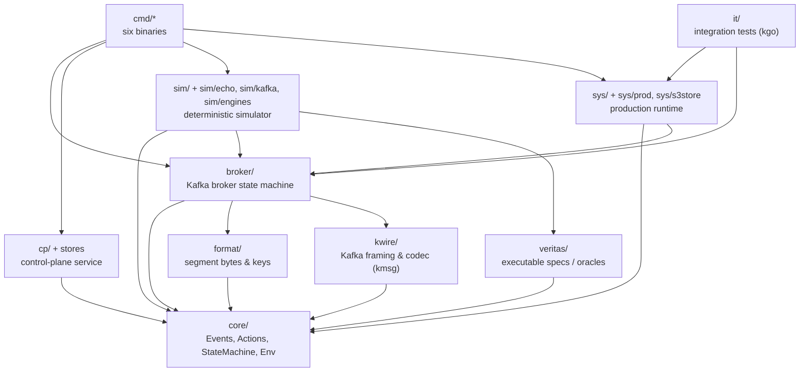

# Chapter 2. The repository has one deterministic centre and six binaries in `cmd/`

This page lists the top-level directories, the dependency rules, the two executors, and the six binaries. Section 2.7 maps a task to the package, file, or command that holds the work. The table in section 2.7 is the lookup that the rest of the book uses.

The Go module is a single module, `manifester` (`go.mod`, Go 1.24). Every import path starts with `manifester/…`. There is no top-level `internal/` directory. Convention, package documentation, and the determinism gate set the boundaries. The compiler does not hide packages. Any package can import any other package. Authors follow the stated boundaries.

## 2.1 The tree lists the top level and the subpackages you open first

The tree lists the top level and the subpackages you open first. Test files (`*_test.go`) sit beside the code the test files test throughout the repository.

```text
.
├── core/          Deterministic heart: Event/Action plain data, StateMachine, Env
├── broker/        Kafka broker state machine (pure, deterministic; core.Machine)
├── cp/            Control-plane service: HTTP handler + Store implementations
│   ├── applier/     Log-backed CP state machine over an ordered KV (decision 49)
│   │   └── pebblekv/  applier's Pebble-backed KV
│   ├── cpclient/    Broker-side HTTP client for the control plane
│   ├── cpobs/       Prometheus collectors for manicp (incl. sequencer metrics)
│   ├── cptest/      Shared conformance suites every Store must pass
│   ├── dynamo/      DynamoDB transaction Store + in-process Sequencer
│   │   └── fakedb/    In-memory DynamoDB fake used by dynamo tests
│   ├── logcp/       Log-backed CP service (DynamoDB log → applier; design A)
│   │   └── logcptest/   Test helpers for logcp
│   ├── logsm/       Prototype log state machine (not wired into manicp)
│   └── memstore/    In-memory Store: the spec behind a mutex
├── sim/           Deterministic simulator kernel (one goroutine, one counted RNG)
│   ├── echo/        Milestone-1 toy broker/workload smoke system
│   ├── engines/     Simulated outside world: cpengine/, logengine/,
│   │                netsim/, objstore/ (+ internal/ test support)
│   └── kafka/       Sans-I/O Kafka clients, oracle, invariants for sim runs
├── sys/           Production seam: narrow interfaces over real I/O
│   ├── awsobs/      AWS observability helpers
│   ├── httppool/    HTTP connection pooling helpers for CP clients
│   ├── prod/        Production wiring: clock, Env, executor, TCP Net, metrics
│   ├── runinfo/     Run id, log-level parsing, startup manifest
│   └── s3store/     S3 ObjectStore adapter (C3-checked against veritas)
├── kwire/         Pure Kafka wire layer: framing + codec over franz-go kmsg
├── format/        Segment object byte layout and segment-key naming (pure)
├── veritas/       Executable specs (oracles) of the outside world
│   ├── veritastest/   Shared lockstep checks for spec implementations
│   └── vsys/          Production-facing adapters over the specs (test fakes)
├── api/
│   └── openapi/   OpenAPI 3.1 spec of the CP HTTP API (+ cmd/specgen, json2yaml/)
├── cmd/           The six binaries (§2.4) — thin main packages over the above
├── it/            Integration tests: real brokers + real franz-go (kgo) clients
├── tools/
│   └── detcheck/  The determinism analyser (§2.3) + allow.txt allow-list
├── scripts/       audit-dep.sh, build-omb.sh, ci-determinism.sh, it-up/down.sh
├── deploy/        docker-compose.yml (test backends); aws/ (Terraform + bench)
├── docs/          Design record: decisions.md, lessons.md, runbooks (§2.6)
├── build/         Generated/local artefacts — do not edit (§2.5)
├── results/       Benchmark experiment outputs — do not edit (§2.5)
├── Makefile       make build is the full gate (§2.2)
├── crap-baseline.json  Checked-in CRAP ratchet baseline for cmd/crapscore
└── go.mod / go.sum     Single module: manifester
```

Directories named after a thing are libraries. The `broker/`, `format/`, and `kwire/` directories are examples. The `cmd/` directory holds argument parsing and wiring. The `sys/` package and the `sim/` package execute the same state machines. The `sys/` package uses real sockets and S3. The `sim/` package uses a seed and replays a run.

## 2.2 The deterministic packages sit at the centre and the edge packages hold the nondeterminism

The repository has layers. The centre reproduces a run bit for bit for a given seed. Each layer outward adds more of the real world. The outer layers add clocks, goroutines, sockets, and cloud SDKs. The outer layers lose reproducibility.



Each arrow points from the importing package to the imported package. Five rules account for most arrows and most missing arrows.

- `core/` imports almost nothing. The `doc.go` file in `core/` is the contract. The package defines plain-data `Event` values and `Action` values. The package defines the `StateMachine` contract. The package defines the `Env`. The `Env` admits the permitted nondeterminism. The permitted nondeterminism covers randomness, "buggify" fault injection, and assertion recording. The package uses no `time`, `math/rand`, `crypto/rand`, `os`, `net`, `sync`, or SDK. The package uses no goroutines, channels, or `select`. Map iteration never decides behaviour. Today `core` imports a short allow-list of standard packages. The list includes `fmt` and `strconv`.
- Pure libraries sit on `core` alone. The `format/` package defines segment layout and `SegmentKey`. The `kwire/` package defines framing and codec. The `kwire/` package has the one audited third-party import, `github.com/twmb/franz-go/pkg/kmsg`. The `veritas/` package holds sequential, fault-free specs. The specs cover `ObjectStore`, `ControlPlane`, and one Kafka `Partition`. These libraries depend on `core` and the standard library. The libraries never depend on `sys/`, on `cp/`, or on a cloud SDK. The `broker/` package composes the pure libraries. The `broker/` package imports `core`, `format`, and `kwire`. The package imports nothing that performs input or output.
- The same machine runs in both executors. The `broker.Broker` type is a `core.Machine`. The `sys.Run` function in `sys/run.go` drives the machine in production from goroutines, sockets, and timers. The `sim/` kernel drives the same code from one goroutine, one counted RNG, and one global queue (`sim/doc.go`). The simulator never implements `sys` interfaces. Production never imports the simulator. The two executors meet at the `core` Event and Action vocabulary in `sys/sys.go`.
- The control plane is an edge, not the core. The `cp/doc.go` file describes `cp/` as "not deterministic (goroutines, `net/http`)". The `cp/` package sits outside the determinism gate. The `veritas.ControlPlane` spec is the executable spec for the control plane. The `cp/cptest` suite checks every `Store` operation against the spec, operation for operation. The stores are `cp/memstore`, `cp/dynamo`, and `cp/logcp` through `cp/applier`.
- The `cmd/` directory and the `it/` directory may import anything. The two directories form the outer layer. Flag parsing, AWS SDK setup, and Prometheus live in the outer layer. The real `kgo` client lives in `it/` only. An SDK import belongs in an edge package. The deterministic packages `core/`, `broker/`, `format/`, `kwire/`, and `sim/` hold no SDK import.

### The two gates check imports and record third-party audits

The `tools/detcheck` tool is a `go/analysis` checker in `tools/detcheck/detcheck.go`. The command `go run ./tools/detcheck` runs the checker. The checker checks imports against an exact-path allow-list. The tool embeds the list from `tools/detcheck/allow.txt`. The list covers standard library basics, `manifester/...`, and the single audited import `github.com/twmb/franz-go/pkg/kmsg`. The checker reports the following items.

- Imports that the list does not name.
- `go` statements, channel types, channel sends, channel receives, and `select`.
- Ranging over a map. Go randomises that order.
- Map iteration that reflect builds.
- Mutable package-level variables. Error sentinels are the exception.

A same-line or previous-line `//detcheck:ok <reason>` comment suppresses a finding. The reason is mandatory. The checker does not check test files.

The `scripts/ci-determinism.sh` script runs detcheck in CI. The `build/ci/determinism.workflow.yml` file wires the script into CI with `go vet` and `go test ./...`. The package list is `./core/... ./sim/... ./format/... ./kwire ./broker/... ./veritas ./veritas/veritastest`. The script then makes two more checks. The script verifies audit records. Every third-party module that those packages touch needs a reviewed record at `docs/dep-audits/<module>@<version>.md` for the exact version in `go.mod`. A version bump breaks the gate. A new audit with `scripts/audit-dep.sh` restores the gate. The script also runs each `TestDeterminismCanary`. Every seed runs twice. The two runs produce identical results. A third-party dependency in the deterministic packages needs a record in `docs/dep-audits/` and the exact path in `allow.txt`.

The `make build` command is the everyday gate in the `Makefile`. The command runs `gofmt` checking. The command runs `go vet ./...`. The command runs `go build ./...`. The command runs `go test -coverprofile` into `build/cover.out`. The command runs the CRAP gate in `cmd/crapscore` (section 2.4) with threshold `CRAP_THRESHOLD` (default 30) against `crap-baseline.json`. The `make crap-baseline` command regenerates that baseline, and the diff carries the same weight as a code diff. The `make crap-strict` command lists all offenders.

## 2.3 The two executors live in `sim/` and `sys/`

Later chapters move between simulation and production. The deterministic executor is `sim/`. The files `sim/kernel.go`, `sim/runner.go`, and `sim/run.go` provide `NewRand`, `NewScheduler`, `NewTimeline`, `NewNodeInbox`, `NewCostModel`, `NewRunner`, and `RunSeed`. The `sim/engines/` directory simulates the object store, the control plane, the log, and the network. The `sim/kafka/` directory holds Kafka clients with no input or output, the oracle, and invariants. The `sim/echo/` directory is the small milestone-1 smoke system. The directory is the first simulator code you meet.

The production executor is `sys/`. The `sys/sys.go` file defines the narrow interfaces `Clock`, `ObjectStore`, `ControlPlane`, `Conns`, `Classifier`, and `Sink`. The `sys/run.go` file holds the single-goroutine event loop, `sys.Run`. The `sys/prod/` directory supplies the clock, the `Env`, the executor, TCP networking, and fact-to-Prometheus wiring. The `cmd/manibroker` binary and the `it/` directory share that wiring. The `sys/s3store/` directory is the S3 adapter. Neither executor puts the executor types into `core`. Code at the edge classifies SDK and HTTP errors into plain `core.ErrCode` and `core.Outcome` values through `sys.Classifier`.

## 2.4 Each of the six binaries in `cmd/` has the same shape

Every binary has the same shape. The `main()` function has a few lines. A testable `run(...)` function does the work. The function returns an exit code. Code 0 means success. Code 1 means runtime failure. Code 2 means usage errors or flag errors. The standard `flag` package parses flags into a struct. The header comment in each `main.go` file gives a one-paragraph description of the program.

### `cmd/manibroker` runs one Kafka broker

The `manibroker` binary runs a single Kafka broker over S3 for the data plane and over the control plane for offset assignment. The `cmd/manibroker/main.go` file describes the binary as a program that "runs one Kafka broker over S3 and the control plane." The binary wires `broker` into `sys/prod`. The `broker` package supplies the state machine. The `sys/prod` package supplies the executor, TCP, and metrics. The wiring uses `cp/cpclient` and `sys/s3store`. The binary takes the following flags.

- `-listen` (default `127.0.0.1:9092`) and `-advertise` name the listen address and the advertised address.
- `-broker-id` and `-node-id` name the broker and the node.
- `-cp-url` (default `http://127.0.0.1:8080`) names the control plane. A comma-separated list in `-cp-url` fails over for the log-backed control plane.
- `-objects s3|mem` selects the object store. The S3 flags are `-s3-endpoint`, `-s3-bucket`, `-s3-prefix`, `-s3-region`, `-s3-path-style`, and `-s3-create-bucket`.
- The segment tuning flags are `-segment-bytes` (default `16MiB`), `-segment-window`, `-max-segment-partitions`, and `-max-segment-batches`.
- The buffer flags are `-max-buffered` and `-resume-buffered`.
- The timeout flags are `-obj-timeout`, `-commit-deadline`, and `-stop-grace`.
- `-metrics-addr` (default `:9100`) names the metrics address.
- `-log-level` and `-debug` name the log level and the debug switch.
- `-run-id` and `-manifest-out` name the run id and the manifest path.

In a local stack, `manibroker` starts second, after a control plane exists for `-cp-url`.

### `cmd/manicp` serves the control plane over HTTP

The `manicp` binary "serves the control plane over HTTP" (`cmd/manicp/main.go`). The binary serves `cp.NewHandler` over your choice of `Store`. The `-store` flag takes the following values.

- `mem` is the default (`cp/memstore`).
- `dynamo` selects the DynamoDB transaction store. The value turns `-sequencer` on by default. The store also takes `-seq-pipeline`, `-seq-max-group-items`, and `-seq-cache-keys`. A stack with this store has one `manicp` process, and every broker points `-cp-url` at that process.
- `dynamolog` selects the log-backed control plane of decisions 48-53. The flags for the value live in `cmd/manicp/logstore.go`. The flags include `-table`, `-ckpt-bucket`, `-node-name`, `-rank`, `-takeover-after`, and `-pebble-dir`.

The common flags follow.

- `-addr` (default `:8080`) names the HTTP address.
- `-dynamo-endpoint`, `-region`, `-table-prefix` (default `manifester_`), and `-create-tables` name the DynamoDB endpoint, the region, the table prefix, and the table creation switch.
- `-metrics-addr` (default `:9101`) names the metrics address.
- `-log-level`, `-run-id`, and `-manifest-out` name the log level, the run id, and the manifest path.

In a local stack, `manicp` starts first. The binary serves the HTTP contract in `api/openapi/controlplane.yaml`.

### `cmd/manisim` runs a scenario campaign through the deterministic simulator

The `manisim` binary "runs a scenario campaign … through the deterministic simulator" (`cmd/manisim/main.go`). The binary is not a deterministic package. The binary reads flags and the wall clock. The binary shards independent seeds over goroutines in `cmd/manisim/merge.go`. The binary takes the following flags.

- `-scenario` takes `kafka` (the default), `kafka-log`, or `echo`.
- `-seeds` (default 100) and `-start` (default 1) set the seed count and the first seed.
- `-seed N` replays one seed and prints the log for that seed.
- `-v` prints one line per seed.
- `-j` sets parallel shards (default `runtime.NumCPU()`).

Exit code 1 has four causes.

- A seed fails.
- A run breaks an `Always` invariant.
- A run shows nondeterminism.
- A campaign of at least `coverageMin` (100) seeds never satisfies a `Sometimes` property.

The command `go run ./cmd/manisim -seed 42` replays seed 42.

### `cmd/manibench` generates produce load for `manibroker`

The `manibench` binary is a produce-only load generator for `manibroker`. The binary follows the WarpStream CLI benchmark-producer (`cmd/manibench/main.go`). The binary has one subcommand, `benchmark-producer`. The command `manibench benchmark-producer -topic T` requires `-topic T`. The subcommand takes the following flags.

- `-brokers` and `-num-clients` name the brokers and the client count. Each client is an independent `kgo` client. The client sets `acks=all`. The client disables idempotence.
- `-record-size`, `-duration` (default 30s), and `-interval` set the record size, the run length, and the report interval.
- `-partitions` selects the partitioner. Value 0 selects the kgo sticky partitioner. Value N selects round-robin.
- `-max-inflight`, `-buffered-records`, and `-compression` (`none|gzip|snappy|lz4|zstd`) set the in-flight limit, the buffer size, and the compression.
- `-cp-url` with `-create-partitions N` creates the topic first through `POST /v1/create-topic`.

The binary prints one line per interval. The binary prints a summary at the end or on SIGINT. The binary is not part of the determinism gate.

### `cmd/crapscore` computes the CRAP score for every Go function

The `crapscore` binary computes the CRAP (Change Risk Anti-Patterns) score of every Go function. The binary uses cyclomatic complexity and a coverprofile. The binary fails when a function is too crappy (`cmd/crapscore/main.go`). The binary uses the standard library, and the dependency policy requires that limit. The `Makefile` drives the binary. The `-profile` flag is required. The other flags follow.

- `-threshold` takes the default from `CRAP_THRESHOLD`, else 30.
- `-baseline` takes the default `crap-baseline.json`.
- `-merge-profile`, `-tolerance`, `-top`, `-exclude`, and `-json` set the merge profile, the tolerance, the report size, the exclusions, and the JSON output.
- `-strict` ignores the baseline.
- `-update-baseline` rewrites the baseline.

The `make crap` command and the `make crap-strict` command run the binary. The `docs/crap-gate.md` file describes the gate.

### `cmd/ddbprobe` probes DynamoDB load

The `ddbprobe` binary is a small DynamoDB load tool with one purpose. The binary runs the commit-path experiments X1, X3, and X4 (`cmd/ddbprobe/main.go`). The results sit in `docs/x1-x3-x4-results.md`. The binary runs on an EC2 instance in the region of the table. The binary prints one JSON summary. The binary takes the following flags.

- `-mode` takes `put|txn|contend|query|batch`.
- `-table` is required.
- `-region` takes the default `ap-south-2`.
- `-rate`, `-k` (max in flight), `-writers`, `-size`, and `-gsize` set the rate, the in-flight limit, the writer count, and the record sizes.
- `-per`, `-parts`, and `-dur` (default 2m) set the period values, the partition count, and the run length.
- Query mode adds `-window`, `-qkind`, `-gap`, and `-start`.

The DynamoDB numbers in the results file come from this tool.

> A seventh `main` sits outside `cmd/`. The `api/openapi/cmd/specgen` program renders `api/openapi/controlplane.json` as `controlplane.yaml` (`go run ./api/openapi/cmd/specgen`). The `-check` flag verifies only. The program is a code-generation utility. The program is not a deployable service.

## 2.5 `build/` and `results/` hold outputs, and two checked-in files come from generators

The `build/` directory holds local build artefacts. The directory holds no source. The `make test` command writes `build/cover.out`. The `crapscore` binary reads that coverprofile. The `make test` command also generates a `build/.gitignore` file that contains `*`. The directory ignores itself. The `build/kafka/` directory holds a downloaded Kafka tarball. The `build/omb/` directory holds the OpenMessaging Benchmark checkout and tarball. The `scripts/build-omb.sh` script builds the tarball. The script uses Docker and a pinned Maven image. The output is `build/omb/openmessaging-benchmark.tar.gz`. A deletion of `build/` loses no source. The scripts and the `Makefile` recreate the files that the scripts and the `Makefile` need.

The `results/` directory holds recorded benchmark experiment outputs in `r1/`, `w1/`-`w4/`, `x1x3x4/`, and more. The `docs/*-results.md` write-ups refer to these outputs. The directory is read-only evidence. A file in `results/` does not state current behaviour. A new benchmark run states current behaviour.

Some source directories hold generated files. The `api/openapi/controlplane.yaml` file is the main case. The `cmd/specgen` program generates the YAML file from `controlplane.json`. The JSON file is the source of truth. A test fails if the two files drift. The JSON file carries the edit, and regeneration produces the YAML file. The `crap-baseline.json` file changes through `make crap-baseline`. The diff on that file carries the same weight as a code diff.

Unexpected changes in `git status` come from three places.

- The `build/` directory holds build artefacts.
- The `results/` directory holds benchmark outputs.
- Regenerated spec and baseline files hold generator output.

## 2.6 `docs/` holds the decision log, the lessons, the design notes, and the runbooks

The `docs/` directory holds the project record. The directory is flat. The `docs/decisions.md` file is the numbered decision log. Package comments cite the log as "decision 41" and "decision I". A comment that cites a number points at that row first. The `docs/lessons.md` file holds the lessons behind the determinism rules. The directory also holds design notes and experiment write-ups. The files are `docs/log-cp-service.md`, `docs/sim-log-engine.md`, `docs/commit-path-redesign.md`, and `docs/benchmarks.md`. The directory holds runbooks in `docs/aws-benchmark-runbook.md`. The directory holds audit records in `docs/dep-audits/`. This book lives in `docs/onboarding/`. The API contract lives with the code in `api/openapi/README.md` and `api/openapi/controlplane.yaml`. The code and the `doc.go` files state the current behaviour when a doc and the code disagree. The doc fix lands in the same change as the code fix.

## 2.7 The table maps a task to the package, the file, or the command that holds the work

| If you want to… | Go to… |
|---|---|
| Understand the Event and Action vocabulary that everything speaks | `core/` (`core/doc.go`, `core/event.go`, `core/action.go`, `core/machine.go`) |
| Change what a Kafka produce or fetch does | `broker/` (`broker/broker.go`, `broker/produce.go`, `broker/fetch.go`) |
| Change segment sealing, buffering, or flow-control limits | `broker/config.go`, flags in `cmd/manibroker/main.go` |
| Change the segment object byte format or segment keys | `format/format.go`, `format/key.go` |
| Add or fix a Kafka wire encoding | `kwire/` (`kwire/codec.go`, `kwire/framer.go`, `kwire/supported.go`) |
| Change control-plane HTTP routes or wire types | `cp/handler.go`, `cp/wire.go`, then sync `api/openapi/controlplane.json` |
| Add a control-plane storage backend | A backend implements `cp.Store` (`cp/store.go`), passes `cp/cptest`, and follows `cp/memstore/` as the model |
| Debug offset assignment or commit contention (DynamoDB) | `cp/dynamo/` (`commit.go`, `seq.go`). The design sits in `cp/doc.go` |
| Work on the log-backed control plane | `cp/logcp/`, `cp/applier/`, flags in `cmd/manicp/logstore.go` |
| See the "obviously correct" spec an implementation must match | `veritas/` (`veritas/controlplane.go`, `veritas/objectstore.go`, `veritas/partition.go`) |
| Reproduce a simulation failure from a seed | `go run ./cmd/manisim -seed <N>`. The kernel sits in `sim/runner.go` and `sim/kernel.go` |
| Add a fault, engine, or invariant to the simulator | `sim/engines/`, `sim/kafka/invariants.go`, `sim/roles.go` |
| Learn the simulator on something small first | `sim/echo/` (toy broker, workload, invariants) |
| Change production networking, executor, or metrics wiring | `sys/prod/` (`node.go`, `executor.go`, `net.go`, `metrics.go`) |
| Change how S3 errors become acks | `sys/s3store/classify.go`, `sys/sys.go` (`Classifier`) |
| Run real clients against a real broker end-to-end | `it/` (`it/fullstack_test.go`, `it/hermetic_test.go`), `scripts/it-up.sh` |
| Start a local broker + control plane by hand | `go run ./cmd/manicp` then `go run ./cmd/manibroker` (§2.4) |
| Load-test a broker | `go run ./cmd/manibench benchmark-producer -topic T` |
| Add a dependency to `core/` or `sim/` | `scripts/audit-dep.sh`, record in `docs/dep-audits/`, allow-list in `tools/detcheck/allow.txt` |
| Know why the code is shaped this way | `docs/decisions.md` (cite the row), `docs/lessons.md` |
| Deploy or benchmark on AWS | `deploy/aws/` (Terraform, bench), `docs/aws-benchmark-runbook.md` |
| Find why the build failed on code quality | `make crap-strict`, `docs/crap-gate.md`, `cmd/crapscore/` |

## Key takeaways

- The module has one deterministic centre. The `core/` package is deterministic. The package has few imports. The `tools/detcheck` tool and the `scripts/ci-determinism.sh` script enforce the import rules.
- The same `broker` state machine runs under two executors. The `sim/` package uses a seed and replays a run. The `sys/` package and `sys/prod` use real input and output. The executors meet at `core` Events and Actions.
- The `veritas/` package is the executable spec. Tests check `cp/` stores and `sys/` adapters against the spec. The spec states the intended behaviour.
- Six binaries do six jobs. The `manicp` binary runs the control plane. The `manibroker` binary runs the broker. The `manisim` binary runs the simulator. The `manibench` binary generates load. The `crapscore` binary runs the quality gate. The `ddbprobe` binary probes DynamoDB.
- The `build/` and `results/` directories hold outputs. The `controlplane.yaml` file and the `crap-baseline.json` file are generated files. Generators produce the two files, and no hand edit survives regeneration.

## Checkpoint questions

1. You need to add a helper that reads the wall clock to `core/`. What stops you, and where should the code go instead?

<details>
<summary>Answer</summary>

The `core/doc.go` file bans `time`. The file also bans goroutines, channels, `os`, `net`, `sync`, and SDKs. Nondeterminism enters through `core.Env`. The clock read belongs in the executor. In production, `sys/` and `sys/prod` do the read. The two packages stamp `Event.At` and `Wall` at inbox dequeue. In simulation, the `sim/` kernel and the engines do the read. The `tools/detcheck` tool in `scripts/ci-determinism.sh` rejects a `time` import in `core/`. The import is absent from `tools/detcheck/allow.txt`.
</details>

2. A colleague proposes importing `github.com/prometheus/client_golang` from `broker/` to add a counter. Why is that the wrong layer, and what does the codebase do instead?

<details>
<summary>Answer</summary>

The `broker/` package is in the determinism gate. Prometheus is absent from `tools/detcheck/allow.txt` (decision 36 in `docs/decisions.md`). The broker emits durations as plain `core.Fact` values. Examples are `segment_put_done` and `segment_committed`. The `sys/prod.Metrics.Observe` method turns facts into Prometheus collectors at the edge. The `cmd/manibroker -metrics-addr` flag serves the collectors.
</details>

3. Which binary do you start first in a local stack, with which flag choosing its storage, and which binary points at it with `-cp-url`?

<details>
<summary>Answer</summary>

The `cmd/manicp` binary starts first. Brokers need a control plane at startup. The `-store` flag selects `mem` (default), `dynamo` (with `-sequencer`), or `dynamolog`. Then `cmd/manibroker` points at the control plane with `-cp-url` (default `http://127.0.0.1:8080`).
</details>

4. `git status` shows changes under `build/` and a modified `api/openapi/controlplane.yaml` after you edited the JSON spec. Which of these do you commit, and how were they produced?

<details>
<summary>Answer</summary>

The commit holds the YAML file and the JSON edit. The commit holds no file from `build/`. The `build/` directory holds artefacts that the directory ignores. The artefacts include `build/cover.out` and the OMB and Kafka downloads. The `go run ./api/openapi/cmd/specgen` command generates `controlplane.yaml` from `controlplane.json`. The JSON file is the source of truth. A test fails if the two files drift. Regeneration produces the YAML file, and the commit holds both files together.
</details>

5. A simulation run reports seed 1234 failing. Give the exact replay command and name the packages where the kernel, the Kafka invariants, and the production executor live.

<details>
<summary>Answer</summary>

The command `go run ./cmd/manisim -seed 1234` replays the seed. The flags `-scenario echo` and `kafka-log` apply when the campaign used those scenarios. The kernel is `sim/` (`sim/kernel.go`, `sim/runner.go`). Kafka invariants are in `sim/kafka/invariants.go`. The production executor runs the same machine outside the simulator. The `sys.Run` function in `sys/run.go` drives `sys/prod`.
</details>

## Try it

1. Print the map. Run `go list ./...` and compare it against §2.1. Then run `go run ./tools/detcheck ./core/... ./sim/... ./format/... ./kwire ./broker/...`. Read one rule in `tools/detcheck/allow.txt` alongside `core/doc.go`.
2. Start the small stack. Run `go run ./cmd/manicp -store mem` in one terminal. Run `go run ./cmd/manibroker -objects mem` in another. Then create load with `go run ./cmd/manibench benchmark-producer -topic t -cp-url http://127.0.0.1:8080 -create-partitions 3 -duration 10s`. Stop both processes. Note which process owned which port (`:8080`, `:9092`, `:9100`, `:9101`).
3. Replay a run. Run `go run ./cmd/manisim -scenario echo -seeds 5 -v`. Then run `go run ./cmd/manisim -seed 1`. Find the invariant names in `sim/echo/invariants.go` that the run checked.

## Further reading

- [../decisions.md](../decisions.md). The numbered decision log that comments cite in the code.
- [../lessons.md](../lessons.md). The lessons behind the determinism rules.
- [../crap-gate.md](../crap-gate.md). How `cmd/crapscore` and `crap-baseline.json` work.
- [../log-cp-service.md](../log-cp-service.md). The log-backed control plane behind `manicp -store dynamolog`.
- [../benchmarks.md](../benchmarks.md). Benchmark methodology for `manibench` and `ddbprobe` results.
- [../../api/openapi/README.md](../../api/openapi/README.md). The control-plane HTTP API contract.
- [../../core/doc.go](../../core/doc.go). The deterministic core rules.
- [../../cp/doc.go](../../cp/doc.go). The control-plane, DynamoDB, and Sequencer design.
- [../../sim/doc.go](../../sim/doc.go). Simulator contracts and lane rules.
- [../../veritas/doc.go](../../veritas/doc.go). The executable specs and conformance checks C1-C4.
