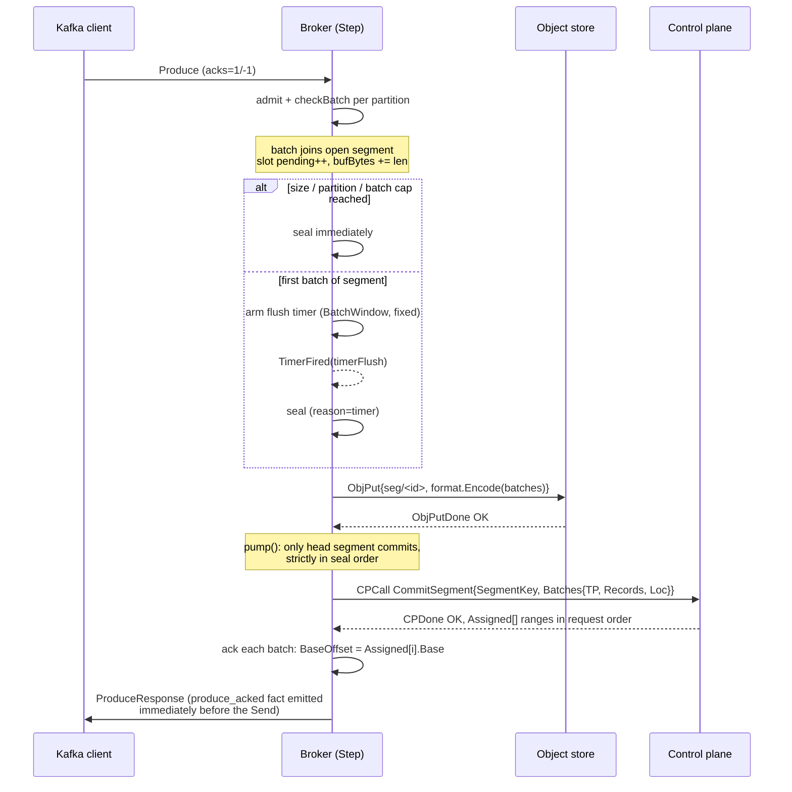
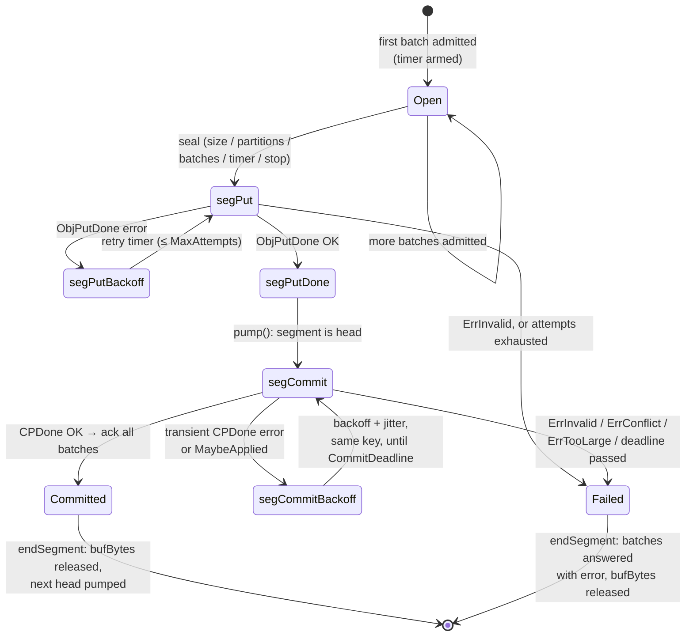

# Chapter 4: the broker acks a produce only after S3 stores the segment and the control plane commits the segment

You meet one rule first because the whole chapter follows from the rule. The broker acks a produce only after S3 stores the segment and the control plane commits the segment. The rule decides the produce path. The rule also decides the fetch path. You pay for the rule with delay and with memory. You gain an ack that names a committed offset.

The broker speaks Produce, Fetch, Metadata, and ListOffsets to clients. The broker stores record batches in S3. The broker asks the control plane to assign offsets. The broker owns no durable log.

`broker.New(cfg)` returns a `core.Factory` in `broker/broker.go`. The simulator and `sys.Run` drive the same broker code in production. One `Step(ev core.Event) []core.Action` call changes broker state. The broker holds no goroutines. The broker reads no clocks. The broker makes no direct S3 calls. The broker makes no direct HTTP calls. Side effects leave the broker as `core.Action` values. Completion events bring the results back to the broker. The sentence the broker uploads means `Step` returns a `core.ObjPut` action.

## 4.1 The package map puts the produce, seal, commit, and fetch code in separate files

| File | What lives there |
|---|---|
| `broker/broker.go` | `Broker` state, `Step` dispatch, timers, stop, backpressure (`flow`) |
| `broker/produce.go` | Produce admission and batch validation (`admit`, `checkBatch`) |
| `broker/segment.go` | Open segment, seal rules, PUT then commit, ack and release |
| `broker/fetch.go` | Fetch, Lookup handling, ranged GET verification, offset patching |
| `broker/metadata.go` | Metadata and ListOffsets responses |
| `broker/ops.go` | `op` retry machinery, request dispatch, topic cache |
| `broker/conn.go` | Per-connection slots, in-order responses, connection lifecycle |
| `broker/config.go` | `Config`, `DefaultConfig`, Kafka error codes, test-only `Bug` mutants |
| `broker/hash.go` | FNV-1a `StateHash` over everything that influences behaviour |

`format/format.go` defines the segment object layout. The layout has a `MSEG` header, an index, and payloads. `format/key.go` defines segment keys. A segment key has the form `seg/<32 lower-case hex>` (decision 43). `kwire/batch.go` parses record-batch headers, checks the CRC, and provides `PatchBatch`. `core/controlplane.go` defines the control plane contract. The contract covers `CommitSegment`, `Lookup`, and `DescribeTopics`. `core/action.go` defines `ObjPut`, `ObjGet`, `CPCall`, `Send`, `PauseReads`, and other actions.

Brokers hold no local state that another broker lacks (decisions 41-44 in `docs/decisions.md`). The system has no broker registration. The system has no epoch. The system has no fencing. The system has no idempotent producers. The broker never proposes an offset. Any broker can serve any partition. Metadata says the same (§4.7).

## 4.2 The open segment gathers batches before the broker seals one object

Incoming produce batches do not become objects one at a time. The batches gather in a single broker-wide buffer. The buffer is the open segment, `openSegment` in `broker/segment.go`.

```go
type openSegment struct {
    batches []*pbatch             // admitted batches, in admission order
    bytes   int                   // sum of len(batch data)
    parts   []core.TopicPartition // distinct partitions present
    gen     core.TimerGen         // flush-timer generation; 0 = none armed
    since   core.Time             // when the first batch arrived
}
```

One open segment mixes topics and partitions. One sealed segment is one object and one control plane commit. The sealed segment may touch many partitions. The control plane assigns each batch an offset in one operation for one segment. The control plane call is `core.CommitSegment` in `core/controlplane.go`. A `pbatch` is one admitted batch on the way through the broker. The `pbatch` points at the request `slot`. The `pbatch` also points at the partition entry inside the Produce response. The broker fills in the response later. The broker fills in one batch at a time as commits land.

The word segment needs one meaning in this file. A segment is the unit that the broker seals, S3 stores, and the control plane commits. Before seal, the segment is open. After seal, the segment is one object under one key.

You read admission as the start of the produce path:

- `produce` in `broker/produce.go` walks every topic and partition of the request.
- `admit` first rejects `acks` other than 1 or -1 with `INVALID_REQUIRED_ACKS` (21).
- `acks=0` never reaches `admit`.
- `dispatch` in `broker/ops.go` marks the slot silent and closes the connection for `acks=0`.
- `admit` next rejects a transactional produce with `INVALID_REQUEST` (42).
- `admit` next rejects an unknown topic or partition with `UNKNOWN_TOPIC_OR_PARTITION` (3), and the topic cache decides the case (§4.7).
- `admit` next rejects a payload that is not exactly one record batch with `CORRUPT_MESSAGE` (2), and `kwire.OneBatch` makes the check.
- `admit` next rejects anything that `checkBatch` rejects (§4.6), and `checkBatch` makes compression-aware header checks.

A rejected partition gets an answer at once with the error code. An accepted batch raises the `pending` count of the slot by one. The batch joins the open segment through `addBatch`. The broker does not answer the batch yet. Validation errors get a fast answer. Success waits until commit (§4.4).

## 4.3 A seal rule ends the wait for more batches

`addBatch` in `broker/segment.go` appends the batch. `addBatch` adds the batch length to `open.bytes`. `addBatch` adds the batch length to broker-wide `bufBytes` (§4.8). `addBatch` records the partition in `open.parts` if the partition is new. `addBatch` then checks the seal rules. Decision 35 sets the rules. Decisions 39 and 52 set the caps again from the costs. `broker/config.go` holds the values.

The broker checks the seal rules in order:

- The broker checks the size rule first, and the broker seals with reason `size` when `open.bytes >= MaxSegmentBytes`.
- The broker checks the partition cap next, and the broker seals with reason `partitions` when the distinct partitions reach `MaxSegmentPartitions`.
- The broker checks the batch cap next, and the broker seals with reason `batches` when the batches reach `MaxSegmentBatches`.
- The broker checks the timer next, and the broker seals with reason `timer` when `BatchWindow` passes after the first batch.
- The broker checks shutdown last, and `stop()` seals with reason `stop` when the broker handles `core.Stop`.

`broker.Config` gives the defaults that you use in the common case. `MaxSegmentBytes` defaults to 16 MiB. `MaxSegmentPartitions` defaults to 4096. `MaxSegmentBatches` defaults to 256. `BatchWindow` defaults to 200 ms.

The detail below changes how you read the caps:

- The batch that reaches the size cap stays in the segment, and a segment overshoots 16 MiB by at most that batch.
- A single batch larger than the cap seals alone, and `broker: oversize batch sealed alone` is an expected reachability fact.
- `TestOversizeBatchSealedAlone` and `TestSizeRuleSealsAtExactlyTheCap` in `broker/flush_test.go` cover the size rule.
- The first batch arms the timer once, and the broker never moves the timer.
- `addBatch` sets `open.since` and a `timerFlush` timer only when the segment goes from empty to one batch.
- Later batches do not extend the 200 ms window, and a steady flow still seals at most 200 ms after the first batch.
- The mutant `BugTimerFromLastBatch` proves that tests catch a window that moves with each batch.
- The caps limit work for the control plane, and a commit costs the control plane about one item for each distinct partition.
- A partition costs about 20 bytes in a log entry, and the long comment on `MaxSegmentPartitions` in `broker/config.go` and `cp/doc.go` gives the cost.
- The value 4096 suits the log-based control plane store, and the DynamoDB transaction store needs `-max-segment-partitions 96`.
- The DynamoDB transaction store refuses wider segments with `ErrTooLarge`, and the broker never retries `ErrTooLarge` (§4.4).
- Sealing cancels the flush timer, emits a `segment_sealed` fact, resets the open segment, and hands the batches to `sealBatches`.
- The fact carries reason, bytes, batches, partitions, age, inflight, and buffered values.

The broker ignores a `TimerFired` when the `Gen` no longer matches `open.gen`. You see the check in `onTimer` in `broker/broker.go`. A timer that fires just after a size seal cannot seal the next segment early.

When the broker seals a segment, `sealBatches` encodes all batches into one object with `format.Encode` in `format/format.go`. The object has a 20-byte `MSEG` header. The object has one index entry for each batch. Each entry holds topic, partition, record count, byte offset and length, and a per-batch CRC32C. The object then holds the batch bytes without changes. The batch bytes sit one after another. Each `pbatch` remembers `core.SegmentRef{Key, Off, Len}` from the index. The control plane later stores the reference. Fetch later reads the reference. The object key is `format.SegmentKey(b.env.NewID())`. The key is `seg/` plus 32 hex digits of a random 128-bit ID. The injected `core.Env` draws the ID. The broker never draws the ID from a request ID (decisions 10 and 43). The broker chooses the key before the first upload attempt. The key never changes. Each retry retries the same object and the same commit.

## 4.4 The broker acks only after S3 stores the segment and the control plane commits the segment

The broker has no offset to give you before the control plane answers. S3 stores bytes but S3 assigns no offsets. The control plane assigns offsets but the control plane stores no batch bytes. An ack before both steps finish names an offset that no fetch can trust. An ack after the S3 write alone still lacks an assigned offset. An ack after the commit alone risks a committed range that points at bytes S3 never stored. The order removes both gaps.

`acks=1` and `acks=-1` get the same treatment. Both values mean committed. The broker has no weaker ack mode.



You follow a common produce in this order:

1. You send a Produce request with `acks=1` or `acks=-1`.
2. The broker runs `admit` and `checkBatch` for each partition.
3. The broker adds each accepted batch to the open segment.
4. The broker raises the `pending` count of the slot by one for each accepted batch.
5. The broker adds the batch length to `bufBytes`.
6. The broker seals the segment when a seal rule fires in §4.3.
7. The broker returns `core.ObjPut` with the segment key and the encoded object.
8. S3 stores the object and returns `ObjPutDone` with an OK result.
9. The broker marks the segment `segPutDone` and calls `pump()` in `broker/segment.go`.
10. The broker starts `CommitSegment` only for the first segment in `b.segs`.
11. The broker starts the commit only when the first segment is `segPutDone`.
12. The control plane assigns one range for each batch and returns `Assigned` in request order.
13. The broker checks that the control plane answers each batch in order for the right partitions.
14. The broker sets `BaseOffset` from `core.BatchRange.Base` for each batch.
15. The broker queues a `produce_acked` fact on the slot for each batch.
16. The broker counts the slot down through `finishPart`.
17. `drain` in `broker/conn.go` emits the facts just before the `core.Send` when the slot reaches zero.

Decision 12 covers the fact order. `TestFactImmediatelyBeforeSend` covers the fact order in a test.

The broker commits segments in seal order. PUT calls for later segments may run while an earlier segment waits. PUT calls may finish in a different order. Only the first segment in `b.segs` starts a commit. A later segment waits in `segPutDone`. The wait keeps control plane offset assignment in broker admission order for a partition. The `segment_committed` fact reports `put_ns + wait_ns + commit_ns = total_ns`. The `wait_ns` value gives the time a segment waits behind earlier commits (decision 36, `broker/timing_test.go`).

If the control plane gives any other answer, the broker raises `AlwaysOrUnreachable`. The broker does not guess a base offset. The `guess` code exists only for the `BugEarlyAck` mutant.

The broker never acks early in real code. Mutation tests check the rule. The test-only `BugEarlyAck` mutant in `broker/config.go` acks batches right after the PUT. The mutant uses offsets that the broker guesses. `TestEarlyAckMutant` in `broker/broker_test.go` must catch the mutant. The conformance suite in `TestConformanceBrokerCatchesMutants` must catch the mutant.

You pay for the order in three concrete ways:

- You wait for the 200 ms `BatchWindow` when no cap seals the segment first.
- You wait for S3 and then for the control plane, and the control plane wait grows when an earlier segment waits ahead of your segment.
- The broker holds your bytes in `bufBytes` until the ack or the error, and `bufBytes` can pause reads at 64 MiB (§4.8).

My view is that the price is right for this system. An ack that follows both steps gives you an offset that a fetch can resolve through the control plane to bytes that S3 stores. A cheaper ack saves time on the common path. The cheaper ack then leaves each fetch to face a range without bytes or an offset without a range. The broker takes the delay once at write time, and readers need no extra rule for such gaps.

If a step fails, every retry resends the same request under the same segment key. S3 treats a replayed PUT under the same key as the same write. The control plane treats a replayed `CommitSegment` as the same commit. A replayed `CommitSegment` returns the ranges that the control plane assigned the first time. The same key with a different request is `ErrConflict` in `core/controlplane.go`.

The retry rules below follow from the same order:

- `ObjPut` gets `MaxAttempts` (6) tries, with backoff `RetryBase` 20 ms doubling to `RetryMax` 640 ms, and the batches then fail with `REQUEST_TIMED_OUT` (7).
- `CommitSegment` gets no count limit, and the broker retries the commit until `CommitDeadline` (120 s from the first attempt).
- Commit backoff doubles to `CommitRetryMax` (2 s), and jitter in `[d/2, d]` from `Env.Intn` picks the exact delay.
- The broker never retries `ErrInvalid` at any stage, and the batches fail with `UNKNOWN_SERVER_ERROR` (-1).
- The broker never retries `ErrTooLarge` on a commit, and `ErrTooLarge` raises an `Unreachable` assertion because the broker and the control plane break the contract.
- The broker never retries `ErrConflict` on a commit, and `ErrConflict` raises an `Unreachable` assertion for the same reason.

Decision 47 sets the commit policy. A control plane restart must not fail each in-flight produce. The segment waits through the outage. The segment bytes stay in `bufBytes` during the wait. Backpressure keeps working during the wait (§4.8). Only the 120 s deadline fails the segment. The deadline stays under the `delivery.timeout.ms` value that producers set. PUT retries and op retries keep the count cap in `retry` and `retryOp`. After the deadline or the attempt cap passes, a `MaybeApplied` write may still land later (decision 15). The client sees a timeout. At-least-once delivery already allows the duplicate that a late write can create (decision 41).

When a segment fails, `failSegment` answers each unanswered batch with the error code. `endSegment` releases the `bufBytes` for the segment. `endSegment` removes the segment from `b.segs`. `endSegment` pumps the commit for the next segment. Success and failure both call `endSegment`. The commit queue cannot stall behind a failed first segment.



The `segState` values in `broker/segment.go` are `segPut`, `segPutBackoff`, `segPutDone`, `segCommit`, and `segCommitBackoff`. The open state is the separate `openSegment` buffer. The broker removes committed segments from `b.segs`. The broker removes failed segments from `b.segs`. The broker keeps no terminal state for a finished segment.

## 4.5 Fetch reverses the produce order through the control plane and then S3

Fetch reads committed data (decision 30). The fetch path starts where the produce rule leaves the data. The control plane holds the committed offset and the byte range. S3 holds the batch bytes. The segment stores the record-batch bytes that the producer wrote. The batch bytes include the `baseOffset` value that the producer wrote. No segment byte holds the committed offset. The broker rewrites the first bytes of each batch on the fetch path. `broker/fetch.go` serves each partition on its own. The broker answers at once. The broker ignores `MinBytes` and `MaxWait` (decision 29). The broker never grants incremental fetch sessions. A request with `SessionEpoch > 0` gets `FETCH_SESSION_ID_NOT_FOUND` (70).

```mermaid
sequenceDiagram
    participant C as Kafka client
    participant B as Broker (Step)
    participant CP as Control plane
    participant S as Object store
    C->>B: Fetch (per-partition FetchOffset)
    B->>CP: CPCall Lookup{TP, From, MaxBytes}
    CP-->>B: LookupResp{Ranges[] in offset order, End}
    Note over B: pick ranges fitting PartitionMaxBytes<br/>(always at least one); set HWM = End
    loop one ranged GET at a time (op.next)
        B->>S: ObjGet{Ref = BatchRange.Loc (Key, Off, Len)}
        S-->>B: ObjGetDone (batch bytes)
        B->>B: ParseBatch: CRC ok, len == Loc.Len,<br/>NumRecords == Range.Count
        B->>B: PatchBatch(data, base = Range.Base, epoch 0)
    end
    B->>C: FetchResponse (RecordBatches = patched bytes)
```

You follow a common fetch in this order:

1. You send a Fetch request with a `FetchOffset` for a partition.
2. The broker starts one `opFetch` for the partition in `broker/ops.go`.
3. The broker sends `core.Lookup{TP, From: FetchOffset, MaxBytes}` to the control plane.
4. The control plane returns ranges in offset order and returns `End` in `LookupResp`.
5. The broker sets `HighWatermark` and `LastStableOffset` to `LookupResp.End`.
6. The broker takes ranges until the next range would pass the partition limit.
7. The broker always takes at least one range, and a batch larger than the limit still goes out whole.
8. The broker issues one `core.ObjGet` for each range in sequence through `o.next`.
9. S3 returns the batch bytes for the byte range in `BatchRange.Loc`.
10. The broker parses the bytes with `kwire.ParseBatch`.
11. The broker checks that the byte length equals `Loc.Len`.
12. The broker checks that the header record count equals `Range.Count`.
13. The broker checks the batch CRC32C over the range bytes.
14. `kwire.PatchBatch(data, base, 0)` rewrites bytes 0-7 to `int64(rg.Base)` and bytes 12-15 to epoch 0.
15. The broker places the patched bytes in the Fetch response.

The broker uses `PartitionMaxBytes` from the request as `MaxBytes` for Lookup. The broker uses `DefaultFetchBytes` (1 MiB) when the request asks for no limit. The broker answers an unknown partition in the response with `UNKNOWN_TOPIC_OR_PARTITION`. The broker answers a negative offset in the response with `OFFSET_OUT_OF_RANGE`. The system has no transactions. The system has no retention. `HighWatermark` and `LastStableOffset` therefore match. A `From` value above `End` gets `OFFSET_OUT_OF_RANGE`. A `From` value equal to `End` gets a successful empty answer.

You read the byte range from `BatchRange.Loc`. The reference holds the segment key and the exact byte offset and length from seal time. The fetch path never reads a whole object. The fetch path never reads the segment header. The fetch path never reads the segment index.

If a GET returns bad bytes, the broker treats the GET as corrupt. The broker retries the GET. S3 checksums cover whole objects. S3 checksums do not cover byte ranges (decision 27). The batch CRC32C covers the range bytes. The broker never serves bytes that fail the checks. `BugServeCorrupt` is the mutant for the rule. If a committed segment returns `ErrNotFound`, the broker raises an `Unreachable` assertion. The broker fails the partition with `KAFKA_STORAGE_ERROR` (56). If retries end with corrupt data, the broker fails the partition with `KAFKA_STORAGE_ERROR` (56) through `exhaustCode` in `broker/ops.go`. Other GET failures and control plane failures retry up to `MaxAttempts`. The failures then end with `REQUEST_TIMED_OUT` (7).

The patch is safe for the CRC. The CRC covers bytes 21 onward. Bytes 0-7 hold `baseOffset`. Bytes 12-15 hold `partitionLeaderEpoch`. Both fields sit outside the CRC. A patched batch still passes client CRC checks (decision 30). `BugWrongOffset` patches `base + 1`. The mutant proves that `TestProduceFetchRoundTrip` checks real offsets.

The broker applies the per-partition limit at Lookup time. The broker applies the request-wide `MaxBytes` last in `finalize` in `broker/conn.go`. Partitions stay in order. After the running total would pass the limit, later partitions get empty `RecordBatches`. The broker never cuts the first non-empty partition.

The broker issues one GET for each range. The broker issues the GET calls for one partition in sequence. The `op` state machine holds `opCP`, `opGet`, and `opBackoff` states. Different partitions run at the same time as independent ops on the same slot.

## 4.6 The broker stores compressed batches as bytes the broker never reads

The broker never decompresses a batch. The produce rule needs the stored bytes to stay exact. Fetch patches only the two fields outside the CRC. Decompression would add work and would add a codec library to the deterministic packages. `checkBatch` in `broker/produce.go` validates one batch from the header alone. `checkBatch` does not read the payload for validation.

The checks give you the following results:

- The magic value must be 2 and the length must match the payload, or the broker returns `UNSUPPORTED_FOR_MESSAGE_FORMAT` (43).
- The CRC32C over the batch bytes must match, or the broker returns `CORRUPT_MESSAGE` (2).
- The codec id in attribute bits 0-2 must be 0-4, and the ids name none, gzip, snappy, lz4, and zstd.
- An id above 4 with a valid CRC gets `UNSUPPORTED_COMPRESSION_TYPE` (76).
- The batch must not be transactional and must not be a control batch, or the broker returns `INVALID_REQUEST` (42).
- `ProducerID < 0` must hold, because the system refuses idempotent producers (decision 41).
- `NumRecords > 0` must hold and `LastOffsetDelta == NumRecords - 1` must hold, or the broker returns `CORRUPT_MESSAGE` (2).

The batch CRC covers each byte after the CRC field. The batch CRC covers compressed records. The batch CRC excludes `baseOffset`. The batch CRC excludes the leader epoch. Fetch rewrites the two excluded fields. A gzip batch follows the full path without broker decompression. The broker admits the batch. S3 stores the batch bytes without changes in the segment. The control plane commits the batch by header record count. Fetch returns the batch bytes and patches the two fields. The consumer decompresses the batch. No codec library enters the deterministic packages (decision I). The broker does not check that the payload decompresses to `NumRecords` records. A producer can set a false record count in the header. Consumers of the producer then receive data with the false count. Offsets use the header count. `broker/compress_test.go` covers mixed-codec segments stored without changes. `broker/compress_test.go` covers the rejection table. `broker/compress_test.go` covers fetch limits in stored compressed bytes.

The section covers decision 45.

## 4.7 Metadata names the answering broker as the leader for each partition

Metadata has no leader election (decision 29, `broker/metadata.go`). The answering broker lists only the answering broker. The broker takes `BrokerID`, `Host`, and `Port` from `Config`. The broker names the broker as leader with epoch 0. The broker names the broker as the sole replica. The broker names the broker as the sole ISR of each partition of each topic that the control plane reports. The broker does not create topics. An unknown topic gets `UNKNOWN_TOPIC_OR_PARTITION` (3). A request by topic ID gets `UNKNOWN_TOPIC_ID` (100). The broker does not support topic IDs. A `nil` topic list means all topics. The broker answers the request from the `DescribeTopics` result.

The broker caches topic shapes in `b.topics` in `broker/ops.go`. `knows(tp)` reads the cache and writes nothing. Produce uses the cache. Fetch uses the cache. ListOffsets uses the cache. If the cache lacks a name, dispatch stores the request in an `opRefresh` op. Dispatch does not fail the request at the miss. The broker issues `DescribeTopics` for the missing names. The broker merges the answer into the cache. Partition counts only grow in the merge, and the merge uses `max`. The broker then runs the stored request once through `resume`. The partition gets an error only when the topic stays unknown after the refresh. Metadata requests use the same op machinery as `opMeta`. If a control plane call fails after retries, the broker marks each requested topic with `LEADER_NOT_AVAILABLE` (5).

ListOffsets in `broker/metadata.go` supports two timestamps. Timestamp -2 means earliest and always gives offset 0. Version 1 has no retention. Timestamp -1 means latest and gives `LookupResp.End`. The broker fetches the latest value with a past-the-end `Lookup{From: 1<<63 - 1, MaxBytes: 1}`. Any other timestamp gets `UNSUPPORTED_FOR_MESSAGE_FORMAT` (43).

## 4.8 Backpressure holds the bytes that the ack rule keeps in the broker

The ack rule keeps produce bytes in the broker until S3 and the control plane finish. `bufBytes` counts produce bytes that the broker admits and does not yet answer. `addBatch` raises `bufBytes`. `endSegment` lowers `bufBytes` on commit and on failure. The count covers the open segment. The count covers PUT calls in flight. The count covers segments that wait behind the first commit. The count covers a segment that waits through a control plane outage inside `CommitDeadline`. At the end of each `Step`, `finish` runs `flow` in `broker/broker.go`.

The flow rules give you the following results:

- `bufBytes >= MaxBufferedBytes` turns pressure on, and the 64 MiB default sets the mark.
- `flow` emits `backpressure_on` and sends `PauseReads` on each client connection.
- `bufBytes <= ResumeBufferedBytes` turns pressure off, and the 32 MiB default sets the mark.
- `flow` emits `backpressure_off` with the paused duration and sends `ResumeReads` on all connections.
- The gap between 64 MiB and 32 MiB stops pause and resume from switching back and forth in quick succession.
- Reads stay paused while `stopping` holds, and the value of `bufBytes` does not change the rule.

The broker does not drop admitted work. Pausing reads stops new bytes. The broker seals each admitted batch. S3 stores the segment. The control plane commits the segment. The broker answers the batch. A batch can fail under the retry budget. One request may pass the pause mark. Admission runs before `flow`. One frame can reach `MaxFrame` (100 MiB). `bufBytes` can pass the pause mark by at most one in-flight request for each connection. The cap bounds steady buffered bytes. The cap is not a hard ceiling. Production holds two or three copies of buffered data. The copies are the frame, the admitted batch, and the encoded segment. `cmd/manibroker` sizes the broker cap from machine memory for this reason in `cmd/manibroker/tuning.go` (decision 35).

Retries form part of flow control. An op stops retrying when the client connection closes. `retryOp` checks `o.s.conn.closed`. Fetch ops give up after `MaxAttempts`. Metadata ops give up after `MaxAttempts`. The ops use the codes in §4.5 and §4.7. The ops do not retry without limit for a caller that has left.

## 4.9 The Config table lists each knob and the default

The table lists all fields of `broker.Config` (`broker/config.go`). Zero numeric and string fields take the `DefaultConfig` value through `withDefaults`. `BrokerID` is the exception. The broker takes `BrokerID` as given. Production flags live in `cmd/manibroker/main.go`.

| Field | Default | Meaning |
|---|---|---|
| `BrokerID` | 1 | Node ID advertised in Metadata |
| `Host` | `localhost` | Advertised host |
| `Port` | 9092 | Advertised port |
| `MaxFrame` | 100 MiB | Largest request frame; a larger one closes the connection (decision 45) |
| `BatchWindow` | 200 ms | Flush timer, armed by the first batch of a segment |
| `MaxSegmentBytes` | 16 MiB | Seal when the open segment holds this many batch bytes |
| `MaxSegmentPartitions` | 4096 | Seal at this many distinct partitions; use 96 for the DynamoDB transaction CP |
| `MaxSegmentBatches` | 256 | Seal at this many batches (bounds CP commit bookkeeping) |
| `MaxAttempts` | 6 | Tries per PUT, op (Lookup/GET/Metadata), before giving up |
| `RetryBase` | 20 ms | First retry backoff; doubles each try |
| `RetryMax` | 640 ms | Backoff ceiling for PUT/op retries |
| `CommitDeadline` | 120 s | How long one segment's commit is retried, from its first attempt (decision 47) |
| `CommitRetryMax` | 2 s | Backoff ceiling for commit retries (jittered `[d/2, d]`) |
| `MaxBufferedBytes` | 64 MiB | Pause all client reads at or above this many unacked produce bytes |
| `ResumeBufferedBytes` | 32 MiB | Resume reads at or below this; forced to `MaxBufferedBytes/2` if unset or above the max |
| `DefaultFetchBytes` | 1 MiB | Per-partition fetch limit when a Fetch asks for none (`<= 0`) |
| `Bug` | `BugNone` (0) | Test-only mutant selector; production must never set it |

## 4.10 Slots keep responses in request order on each connection

Kafka clients send requests before earlier responses return. Clients expect responses in request order. `broker/conn.go` models each connection as a queue of `slot` values. One slot holds one decoded request. One slot holds the response under construction. One slot holds a `pending` count of unfinished parts. One slot holds facts to emit with the response. Handlers in `handle` and `dispatch` in `broker/ops.go` run at once and start async ops. `drain` sends only the first slot. `drain` sends the slot only when the `pending` count reaches zero. `drain` sends slots in queue order. A slow Fetch cannot pass a fast Metadata behind the Fetch. `TestPipelinedResponsesInOrder` covers the rule.

The connection rules give you the following results:

- `onOpen` registers the connection with a `kwire.Framer` bounded by `MaxFrame`, and the broker refuses a known ID.
- The broker refuses a new connection with `CloseConn{Abort: true}` while `stopping` holds.
- `onBytes` feeds the running receive hasher, and the hasher forms part of `StateHash`.
- `onBytes` pushes bytes through the framer and dispatches each complete frame.
- A framing error or a decode error marks the connection `closing`, and the broker reads no new requests from the connection.
- Queued responses still drain from a `closing` connection.
- An unsupported API closes the connection without a response through `s.silent, s.conn.closing = true` in `dispatch`.
- ApiVersions is the exception, and the broker answers ApiVersions for versions that the codec cannot fully decode through `kwire.ApiVersionsResponse`.
- An `acks=0` produce takes the same silent path, and the broker closes the connection after the queue drains.
- `drain` emits `CloseConn{Abort}` when a `closing` queue empties or `abort` holds, and `drain` then drops the connection.
- The broker drops the connection on peer close in `onClosed` and discards answers for the connection.
- `drain` skips connections where `c.closed` holds, and in-flight ops read `conn.closed` and retire in place of retrying.

If you send `core.Stop`, the broker sets `stopping`. The broker seals the open segment with reason `stop`. The broker pauses all reads. The broker refuses new connections. New requests close the connection for the request. `maybeExit` waits until no ops remain. `maybeExit` waits until no sealed segments remain. `maybeExit` waits until no open batches remain. `maybeExit` waits until no queued slots remain. The broker then closes each connection. The broker emits `broker_exited`. The broker returns `core.Exit`. `TestGracefulStop` covers the path.

`broker/hash.go` computes the FNV-1a `StateHash`. The hash folds in the config `Bug` value, counters, topics, connections and slots, the open segment, sealed segments, ops, `bufBytes`, and pressure. The broker writes the hash code. The broker does not use `hash/fnv`, and `hash/fnv` sits outside the deterministic allow-list. The hash excludes pure timing fields. The fields are `sealedAt`, `putDoneAt`, and `pressureAt`. The timing fields feed facts. The timing fields never change behaviour.

## Key takeaways

- One open segment exists for each broker. The open segment mixes partitions.
- The broker seals the open segment at 16 MiB, 4096 partitions, 256 batches, a fixed 200 ms window from the first batch, or shutdown.
- The produce order is `ObjPut`, then control plane `CommitSegment`, then ack. The broker has no offsets that the broker owns.
- An early ack is impossible outside the `BugEarlyAck` test mutant.
- The broker issues commits in seal order and commits the first segment only. The broker retries a commit under the same segment key until the 120 s deadline passes, and PUT calls retry 6 times.
- Fetch runs Lookup, then one ranged GET for each committed batch, then CRC, length, and count checks, then `PatchBatch(baseOffset = committed Base, epoch 0)`.
- The broker validates compression from the batch header and CRC only. The codec ids name gzip, snappy, lz4, and zstd.
- S3 stores compressed batches as opaque bytes, and the broker never decompresses the batches.
- Backpressure is one pair of marks over unacked produce bytes. The broker pauses reads at 64 MiB and resumes at 32 MiB through `PauseReads` and `ResumeReads`, and the broker never drops admitted work.
- Slots for each connection keep responses in request order. The broker emits each `produce_acked` fact just before the `Send` for the fact.

## Checkpoint

<details>
<summary>1. A produce with acks=-1 is PUT to S3 successfully, then the CP is down for 30 s. What does the client see, and when?</summary>

You see nothing at first. You get no ack and no error. The segment sits in `segCommitBackoff`. The broker retries the same `CommitSegment` under the same key. Backoff carries jitter and a cap at `CommitRetryMax` (2 s). The 30 s outage sits inside `CommitDeadline` (120 s). The commit lands when the control plane returns. The control plane assigns offsets. The broker then acks you. The segment bytes count in `bufBytes` during the wait. Backpressure may pause reads during the wait. After 120 s, the batches fail with `REQUEST_TIMED_OUT`.

</details>

<details>
<summary>2. Why can't a later segment commit before an earlier one, even if its PUT finished first?</summary>

`pump()` in `broker/segment.go` starts the commit of `b.segs[0]` only. `pump()` starts the commit only when `b.segs[0]` is `segPutDone`. A later segment that uploads early waits in `segPutDone`. The wait is the `wait_ns` value on `segment_committed`. First-only commits keep control plane offset assignment in broker admission order for each partition.

</details>

<details>
<summary>3. A client fetches offset 100 and the CP returns three ranges. The second GET returns bytes whose header says 40 records but the range says 41. What happens?</summary>

`onFetchGet` in `broker/fetch.go` treats the bytes as a corrupt GET. The broker checks `ParseBatch` output against `Loc.Len` and `Range.Count`. The op emits `corruption_detected`. The op retries the ranged GET. S3 checksums do not cover byte ranges. The batch CRC covers the range bytes. The broker never patches the bad bytes. The broker never sends the bad bytes. If retries end with the corrupt flag set, the partition fails with `KAFKA_STORAGE_ERROR` (56).

</details>

<details>
<summary>4. Why is patching `baseOffset` on fetch safe for the batch CRC, and why does that make compressed batches servable without decompression?</summary>

The v2 batch CRC32C covers bytes 21 to the end. `baseOffset` (0-7) and `partitionLeaderEpoch` (12-15) lie outside the range (decision 30, `kwire.PatchBatch`). Compression sits inside the covered region. The broker never modifies compressed bytes. The broker validates the CRC over the compressed bytes. S3 stores the bytes without changes. The broker serves the bytes without changes. The broker rewrites the two uncovered fields only. The consumer decompresses the batch (decision 45).

</details>

<details>
<summary>5. A single 20 MiB batch arrives at an empty broker with default config. Describe its path and the segment it creates.</summary>

The answer assumes a valid header. `admit` accepts the batch. `addBatch` appends the batch as the first batch. The broker arms the 200 ms timer. The size check then fires at once. The batch size is 20 MiB. The cap is 16 MiB. The broker seals the segment alone with reason `size`. A segment overshoots the cap by at most the last batch. The batch is the segment here. The broker cancels the timer. S3 stores the object under a fresh `seg/<id>` key. The control plane commits the segment. The broker acks you with the base offset that the control plane assigns.

</details>

## Try it

The tasks below use tests that the broker package already holds:

- Run the round trip and seal-rule tests and read the facts that the tests assert.

   ```sh
   go test ./broker/ -run 'TestProduceFetchRoundTrip|TestTimerRuleFromFirstBatch|TestSizeRuleSealsAtExactlyTheCap|TestTwoSegmentsInFlightCommitInOrder' -count=1 -v
   ```

- Use mutation to test the never ack early claim, and read how each `Bug` value wires into `broker/segment.go` and `broker/fetch.go`.

   ```sh
   go test ./broker/ -run 'TestEarlyAckMutant|TestWrongOffsetMutant|TestConformanceBrokerCatchesMutants' -count=1 -v
   ```

- If you change `BatchWindow` and `MaxSegmentBytes` in a test on `broker/flush_test.go` and `broker/harness_test.go`, you predict each `segment_sealed` reason before you run the test.
- If you trace one fetch in `broker/fetch.go`, you follow a range from `core.LookupResp.Ranges` through `core.ObjGet{Ref: rg.Loc}` to `kwire.PatchBatch`, and you confirm that no whole-object GET exists on the path.
- If you run the whole package as CI runs the package, you use `go test ./broker/ -count=1`.

## Further reading

The sources below give you the decisions and the code behind this chapter:

- `docs/decisions.md` records decisions 29 (leaderless metadata), 30 (fetch rewrites offsets), 35 (segment flush rule and caps), 41-44 (no idempotent producers, CP-assigned offsets, flat segment keys, stateless brokers), 45 (compression as opaque bytes), 47 (commit deadline), and 52 (partition cap).
- `broker/config.go` holds the long comment on `MaxSegmentPartitions`. The comment covers how the caps couple the broker to each CP store. `cp/doc.go` describes the CP side.
- `format/format.go` defines the `MSEG` object layout and the per-batch CRCs. Ranged GETs use those CRCs for verification.
- `core/controlplane.go` defines the `CommitSegment` and `Lookup` contract. The contract covers idempotence per segment key.
- `docs/flow-control.md` gives the design background for `PauseReads` and hysteresis. It covers why admission control lives inside `Step`.
- `broker/flush_test.go`, `broker/compress_test.go`, and `broker/timing_test.go` hold executable versions of §4.3, §4.6, and the segment timing facts.
